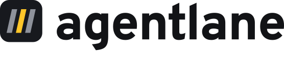

<p align="center">
  <picture>
    <source media="(prefers-color-scheme: dark)" srcset="brand/lockup-dark.svg">
    
  </picture>
</p>

<p align="center"><strong>A running copy of your app for every AI coding agent.</strong></p>

<p align="center">
  <a href="https://www.npmjs.com/package/agentlane"></a>
  <a href="https://github.com/north-star-hq/agentlane/blob/main/LICENSE"></a>
  <a href="https://github.com/north-star-hq/agentlane/actions/workflows/ci.yml"></a>
</p>

agentlane gives each agent session a lane: its own ports, dev servers and database, and its own iOS simulator, Android emulator or browser, with fast tools to see the app and drive it. Agents use it through the `agentlane` CLI, an MCP server (`look`, `run`, `screenshot`), and skills and hooks that teach them the loop. It works with Claude Code, Codex, Cursor, GitHub Copilot, Gemini CLI and Antigravity, on web apps, iOS and Android.

**1. In your project's root:**

```sh
npx agentlane init
```

**2. Then tell your agent:**

```text
Set this project up with agentlane.
```

<sub>`init` wires the agents it finds and adds agentlane to your dev dependencies. Setup then learns how your project runs and brings each app up in its own lane. [Getting started](https://north-star-hq.github.io/agentlane/docs/getting-started.html) walks through both steps.</sub>

<picture>
  <source media="(prefers-color-scheme: dark)" srcset="media/hero-dark.svg">
  
</picture>

## Why agentlane

- **Every agent, one install.** [Six agents](https://north-star-hq.github.io/agentlane/docs/install.html) get the same CLI, MCP server, skills and hooks from one `init`.
- **Web, iOS and Android in one tool.** [`look`, `run` and `screenshot`](https://north-star-hq.github.io/agentlane/docs/drive.html) work the same on a simulator, an emulator or a browser.
- **The whole environment, per agent.** [Ports, dev servers, a database, sign-in](https://north-star-hq.github.io/agentlane/docs/lanes.html), and a device or browser that no other agent touches.
- **Fast.** A warm lane reads the screen in about 0.15 s. See [Speed](#speed).
- **It checks the app before your agent trusts it.** [`doctor`](https://north-star-hq.github.io/agentlane/docs/doctor.html) confirms that every server runs this worktree's code, and names the fix when one doesn't.
- **Evidence you can open.** [Videos, traces, logs and screenshots](https://north-star-hq.github.io/agentlane/docs/evidence.html), plus the Maestro flows and Playwright tests your agent commits.
- **It cleans up.** When a session ends, [its lane is released](https://north-star-hq.github.io/agentlane/docs/guard.html): services stop, databases are torn down, and devices go back to the pool.
- **Local.** No account, no hosted service, [no telemetry of its own](#security-and-telemetry).

## Speed

| On a warm lane, median of 16 calls | iOS simulator | Browser |
| ---------------------------------- | ------------- | ------- |
| Read the screen with `look`        | 0.15 s        | 0.16 s  |
| Take a screenshot                  | 0.16 s        | 0.18 s  |
| Click through `playwright-cli`     |               | 0.81 s  |

What makes it fast:

- **A warm Maestro session.** `look`, `run` and `screenshot` talk to a Maestro session that stays up between calls, so only the first call pays to start it.
- **A runner port per session.** Stock Maestro gives every iOS simulator's runner the same port, 22087, so with two simulators the second one started cold on every call: 6.5 s per screen read, against 0.12 s with our patch.
- **Quick taps.** On Android, `run --quick` skips Maestro's fixed 750 ms window settle and the screen reads after the tap.
- **A build cache your worktrees share.** The example app's iOS build took 91.5 s. A fresh worktree got its build from the cache in 6.5 s and reached the running app in 38.6 s.
- **A device pool.** Lanes reuse simulators and emulators instead of creating new ones, and emulators boot from their Quick Boot snapshot in 1.6 to 1.8 s, against 14.6 s for a cold boot.

[Speed](https://north-star-hq.github.io/agentlane/docs/speed.html) on the docs site explains each one.

<details>
<summary>How these were measured</summary>

All on an Apple M4 Max with 48 GB of memory.

- iOS column: `agentlane bench` on the [example app](examples/expo-app/), two iPhone 17 simulators alternating, release 0.1.3 with the Maestro build agentlane installs (`2.11.0-agentenv.3`). The Mac was under memory pressure, so these are upper bounds.
- Browser column: the same bench on the example's web app, Playwright 1.64.0 with Chrome for Testing, a 0.2.0 development build.
- Port comparison: 16 reads per simulator on another app, stock Maestro 2.8.0 against an early build with the port patch.
- Build cache: single runs of 0.2.0 on the example app. Boot times: two boots each of a Pixel 8 emulator on Android 36.

[`bench/README.md`](bench/README.md) has the method, and `agentlane bench` runs it on your machine.

</details>

## What a lane gives your agent

**Its own environment**

- [Ports](https://north-star-hq.github.io/agentlane/docs/services.html) from a registry on the machine, with your dev servers started on them and checked ready before `up` returns.
- [A database](https://north-star-hq.github.io/agentlane/docs/resources.html), or any resource you declare, created for the lane and torn down when it ends, after a crash too.
- Sign-in through your project's hook, so the app opens signed in.
- A [simulator, emulator](https://north-star-hq.github.io/agentlane/docs/devices.html) or [browser](https://north-star-hq.github.io/agentlane/docs/browsers.html) from a pool. When the pool is full, the request waits for a free device.
- `restart` changes one service's environment, such as a feature flag, without tearing the lane down.

**Eyes and hands**

- `look` reads the screen or page, one line per element, and `--interactive` keeps only what can be tapped or typed into. On iOS, our Maestro patch puts each element's type in the hierarchy to make that possible.
- `run` runs Maestro steps and prints what changed.
- In the browser, Playwright's `playwright-cli` (the default) or agent-browser, run through `agentlane exec`.
- [`record save`](https://north-star-hq.github.io/agentlane/docs/drive.html) turns the session's passing steps into a Maestro flow you can commit.
- `device` sets location, permissions, appearance, push notifications, the clipboard and links to open.
- Before launch, `up` sets the device's location, status bar and keyboard, so captures match from run to run.

**Evidence and housekeeping**

- [`evidence`](https://north-star-hq.github.io/agentlane/docs/evidence.html) keeps videos, Playwright traces, logs and screenshots in a folder that outlives the lane. A failed `run` or `exec` command keeps its own.
- [A hook](https://north-star-hq.github.io/agentlane/docs/guard.html) denies `simctl`, `adb`, `emulator`, `avdmanager`, `playwright-cli` and `agent-browser` commands aimed at another lane's device or browser.
- The next lane taken on the machine cleans up any lane whose session died, and `prune` deletes pool devices no lane holds.

## The skills

[The skills](https://north-star-hq.github.io/agentlane/docs/skills.html) teach an agent the whole loop in your project, from setup to proof. Each stub `init` writes prints its skill from the installed version, so the skills update with the package.

- **setup** finds how your project runs its apps, servers, data and sign-in, wires your agents, writes `agentlane.json`, and brings each app up until `doctor` reports ready. It asks you only what it can't find out.
- **dev-loop** is what an agent follows whenever it runs the app: one lane per session, `up`, `doctor` before trusting an instance, `release` when done, and what counts as proof.
- **drive** covers driving the lane's device or browser, turning what worked into a committed flow or test, and keeping evidence.
- **create-verification-skill** writes your project's run skill, with how to launch, check, drive and capture the app and a page per user-facing feature, and runs it end to end once before it is done.
- **maintain-verification-skill** keeps the run skill and its feature pages true as the app changes. It checks each page against the code, drives each feature, and opens at most one PR of corrections.

Claude Code can load the skills, the MCP server and the hooks as the agentlane plugin, and Codex, Cursor and Gemini CLI have plugins with the skills and the MCP server.

Once setup reports ready, any agent in the project can take work like this:

> Add a "clear completed" button to the list. Bring the app up on iOS and on the web, prove the button works with a Maestro flow and a Playwright test, and record a video of it.

## Where it runs

| Host                 | Web apps | iOS      | Android  |
| -------------------- | -------- | -------- | -------- |
| Mac, Apple silicon   | yes      | yes      | yes      |
| Mac, Intel           | untested | untested | untested |
| Linux, x64 and arm64 | yes      | no       | not yet  |

agentlane needs Node 24 or newer, and Xcode or the Android SDK for mobile apps. It drives simulators, emulators and browsers, not physical devices. On Linux, Chrome needs system libraries that agentlane can't pin; `agentlane doctor` names any that are missing and gives the command that installs them. [Where it runs](https://north-star-hq.github.io/agentlane/docs/requirements.html) on the docs site lists what each platform needs.

## Security and telemetry

agentlane runs on your machine. It has no account, no hosted service and no telemetry of its own.

- On first use it downloads its pinned tools: the patched Maestro from this repository's releases, Playwright and agent-browser from npm, and Chrome for Testing. It checks each against a hash pinned in the package.
- The patched Maestro has its update check, error reporter, screen report and PostHog analytics removed. A check in `maestro/test/` calls every local Maestro tool and sees no connection leave the machine. Maestro's `cheat_sheet` and cloud tools still call Maestro's servers, as they are built to.
- Each lane's iOS runner answers only requests that carry the lane's token, so another process can't drive your simulator through it.
- Playwright and agent-browser run as their maintainers publish them; agentlane doesn't change what they send.
- What your agent reads through `look` and `screenshot` goes to the model it runs on, like any tool output.

To report a vulnerability, see [`SECURITY.md`](SECURITY.md).

## Acknowledgements

agentlane is built on these projects, and we're grateful to their authors:

- [Maestro](https://github.com/mobile-dev-inc/Maestro) drives every simulator and emulator. agentlane ships it with the patches in [`maestro/`](maestro/).
- [Playwright](https://github.com/microsoft/playwright) drives the browser by default, on [Chrome for Testing](https://googlechromelabs.github.io/chrome-for-testing/).
- [agent-browser](https://github.com/vercel-labs/agent-browser) is the other browser driver a lane can run.
- [pstack](https://github.com/cursor/plugins/tree/main/pstack), Lauren Tan's skills for Cursor, is where dev-loop and the two verification skills began. Parts of them are adapted from it under the MIT licence.

Other projects worth knowing, from people working on the same problem:

- [agent-device](https://github.com/callstack/agent-device) by Callstack: mobile automation for agents through a CLI, an MCP server and a Node.js API, on more platforms than agentlane covers.
- [MobileBuildMCP](https://github.com/getsentry/MobileBuildMCP) by Sentry, formerly XcodeBuildMCP: an MCP server and CLI with tools for agents working on iOS and macOS projects.
- The simulator and browser panes in Claude Code Desktop, and the built-in browser Codex uses in the ChatGPT desktop app, which put the running app next to the conversation.

The Android robot in the animation is Google's, used under [CC BY 3.0](https://creativecommons.org/licenses/by/3.0/).

## Documentation

The [docs site](https://north-star-hq.github.io/agentlane/) has per-agent setup, the config and CLI reference, platform requirements and troubleshooting, with an `llms.txt` for agents. [`examples/expo-app/`](examples/expo-app/) is the app agentlane is tested on, and [`CHANGELOG.md`](CHANGELOG.md) lists every release.

## License

[MIT](LICENSE). The patched Maestro is Apache-2.0; [`maestro/`](maestro/) holds its patches and notice.

Made by North Star.
