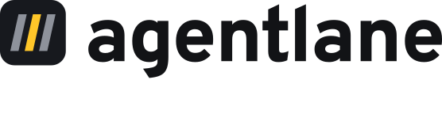

<p align="center">
  <picture>
    <source media="(prefers-color-scheme: dark)" srcset="brand/lockup-dark.svg">
    
  </picture>
</p>

<p align="center">
  
  
  
</p>

<h3 align="center">Stop your coding agents fighting over ports, simulators and databases.</h3>

<p align="center">The fast, light way to run a copy of your app for every agent, with tools to see it and drive it, all at the same time.</p>

<p align="center"><strong>Reads the screen 50x faster than stock Maestro on two simulators.</strong></p>

<picture>
  <source media="(prefers-color-scheme: dark)" srcset="media/hero-dark.svg">
  
</picture>

Whether you run three Claude Code sessions on one Expo app, Codex and Cursor on the same web app, or agents testing iOS and Android at once, agentlane keeps them apart.

agentlane calls each copy a **lane**. Every lane has:

- Its own [ports, dev servers and database](https://north-star-hq.github.io/agentlane/docs/services.html), so no two agents start a server on the same port.
- Its own [iOS simulator, Android emulator or browser](https://north-star-hq.github.io/agentlane/docs/devices.html), which no other agent can touch.
- [`look`, `run` and `screenshot`](https://north-star-hq.github.io/agentlane/docs/drive.html), which see and drive the app the same way on all three.
- [`doctor`](https://north-star-hq.github.io/agentlane/docs/doctor.html), which checks that every server runs this worktree's code before the agent trusts it.
- [Videos, traces, logs and screenshots](https://north-star-hq.github.io/agentlane/docs/evidence.html) the agent keeps as proof.
- [Cleanup](https://north-star-hq.github.io/agentlane/docs/guard.html) when the agent is done: servers stop, databases go, and devices go back to the pool.

It works with Claude Code, Codex, Cursor, GitHub Copilot, Gemini CLI and Antigravity, on web apps, iOS and Android. It runs on your machine, with no account.

## Install

**1. In your project's root:**

```sh
npx agentlane init
```

**2. Then tell your agent:**

```text
Set this project up with agentlane.
```

Once setup reports ready, any agent in the project can take work like this:

> Add a "clear completed" button to the list. Bring the app up on iOS and on the web, prove the button works with a Maestro flow and a Playwright test, and record a video of it.

## Speed

An agent reads its screen in **0.12 s**, where stock Maestro takes 6.5 s with two simulators running.

|                                     | With agentlane               | Without                |
| ----------------------------------- | ---------------------------- | ---------------------- |
| Read the screen, two iOS simulators | 0.12 s                       | 6.5 s on stock Maestro |
| iOS build in a fresh worktree       | 6.5 s from the shared cache  | 91.5 s                 |
| Boot an Android emulator            | 1.6 to 1.8 s from Quick Boot | 14.6 s cold            |

[How we measured, and what makes it fast](https://north-star-hq.github.io/agentlane/docs/speed.html)

## The skills

[The skills](https://north-star-hq.github.io/agentlane/docs/skills.html) teach an agent the whole loop in your project, from setup to proof. Each stub `init` writes prints its skill from the installed version, so the skills update with the package.

- **setup** finds how your project runs its apps, servers, data and sign-in, wires your agents, writes `agentlane.json`, and brings each app up until `doctor` reports ready. It asks you only what it can't find out.
- **dev-loop** is what an agent follows whenever it runs the app: one lane per session, `up`, `doctor` before trusting an instance, `release` when done, and what counts as proof.
- **drive** covers driving the lane's device or browser, turning what worked into a committed flow or test, and keeping evidence.
- **device** is drive's old name. It sends any run skill that still loads `device` to drive.
- **create-verification-skill** writes your project's run skill, with how to launch, check, drive and capture the app and a page per user-facing feature, and runs it end to end once before it is done.
- **maintain-verification-skill** keeps the run skill and its feature pages true as the app changes. It checks each page against the code, drives each feature, and opens at most one PR of corrections.

Claude Code can load the skills, the MCP server and the hooks as the agentlane plugin, and Codex, Cursor and Gemini CLI have plugins with the skills and the MCP server.

## agentlane and the tools you already use

agentlane is the same idea as a git worktree, for the running app. A worktree gives each agent its own copy of the code, and a lane gives it its own copy of the app, up and running.

### agentlane and Simlock

[Simlock](https://github.com/callstackincubator/simlock), from Callstack, leases iOS simulators, Android emulators and enrolled phones to coding agents that run in parallel. An agent asks for a device and gets one back, booted and checked, that no other agent touches until it lets go. A lane does the same for simulators, emulators and browsers, and adds the rest of the running app around the device: its ports, dev servers and database.

### agentlane and agent-device

[agent-device](https://github.com/callstack/agent-device), also from Callstack, lets coding agents control mobile, TV, desktop and web apps through a CLI, an MCP server and a Node.js API, on more platforms than agentlane covers. A lane gives the agent a simulator, emulator or browser of its own, with the app's servers already up for it, and `look`, `run` and `screenshot` to drive it.

### agentlane and portless

[portless](https://github.com/vercel-labs/portless), from Vercel Labs, replaces port numbers with stable, named `.localhost` URLs, for people and agents alike, and gives each linked worktree a subdomain of its own. A lane hands out the ports themselves, starts your dev servers on them and waits until they answer, then adds the database and the device the app needs.

### agentlane and worktrunk

[worktrunk](https://github.com/max-sixty/worktrunk) is a CLI for git worktrees, designed for running AI agents in parallel: you switch, list and remove worktrees by branch name, with hooks and shared build caches. It gives each agent its own copy of the code. A lane runs the app from that copy, and the same session in a second worktree gets a second lane.

### agentlane and Playwright

[Playwright](https://github.com/microsoft/playwright) drives Chromium, Firefox and WebKit with one API, in tests, in scripts and as a tool for AI agents, and its `playwright-cli` is built for coding agents. agentlane drives the browser with it by default. A lane gives each agent its own Chrome for Testing, with a profile no other lane can read, and its hook stops one agent's commands from reaching another lane's browser.

### agentlane and Maestro

[Maestro](https://github.com/mobile-dev-inc/Maestro) tests Android, iOS and web apps through flows written in YAML, and its MCP server lets coding agents drive a live device. agentlane drives every simulator and emulator with it. Its patches give each iOS simulator's runner a port of its own, so a second simulator doesn't start cold on every call, and keep a Maestro session warm between calls.

### agentlane and Conductor

[Conductor](https://www.conductor.build/) runs Claude Code, Codex and Cursor agents in parallel, each in an isolated workspace, on your Mac. A lane gives each of those agents a running copy of the app as well: ports, dev servers, a database, and a simulator, emulator or browser.

### agentlane and Paradev

[Paradev](https://github.com/superset-sh/superset), formerly Superset, is an open-source desktop app for running CLI coding agents in parallel. Each task gets its own git worktree, branch and terminals, and a built-in browser previews each workspace's dev server. A lane claims its ports before the servers start, and adds a database and an iOS simulator or Android emulator for each agent.

### agentlane and your agent's own worktrees

Claude Code's `--worktree`, the Codex app's worktrees and Cursor's worktrees each give an agent its own checkout, so parallel edits don't collide, and Cursor can run setup commands in every new one. A lane starts where the checkout ends: the app running from that worktree's code, on ports, a database and a device of its own, with `doctor` to confirm every server runs that code.

## Where it runs

| Host                 | Web apps | iOS      | Android  |
| -------------------- | -------- | -------- | -------- |
| Mac, Apple silicon   | yes      | yes      | yes      |
| Mac, Intel           | untested | untested | untested |
| Linux, x64 and arm64 | yes      | no       | not yet  |

agentlane needs Node 24 or newer, and Xcode or the Android SDK for mobile apps. It drives simulators, emulators and browsers, not physical devices. On Linux, Chrome needs system libraries that agentlane can't pin; `agentlane doctor` names any that are missing and gives the command that installs them. [Where it runs](https://north-star-hq.github.io/agentlane/docs/requirements.html) on the docs site lists what each platform needs.

## Security and telemetry

agentlane runs on your machine. It has no account, no hosted service and no telemetry of its own.

- On first use it downloads its pinned tools: the patched Maestro from this repository's releases, Playwright and agent-browser from npm, and Chrome for Testing. It checks each against a hash pinned in the package.
- The patched Maestro has its update check, error reporter, screen report and PostHog analytics removed. A check in `maestro/test/` calls every local Maestro tool and sees no connection leave the machine. Maestro's `cheat_sheet` and cloud tools still call Maestro's servers, as they are built to.
- Each lane's iOS runner answers only requests that carry the lane's token, so another process can't drive your simulator through it.
- Playwright and agent-browser run as their maintainers publish them; agentlane doesn't change what they send.
- What your agent reads through `look` and `screenshot` goes to the model it runs on, like any tool output.

To report a vulnerability, see [`SECURITY.md`](SECURITY.md).

## Acknowledgements

agentlane is built on these projects, and we're grateful to their authors:

- [Maestro](https://github.com/mobile-dev-inc/Maestro) drives every simulator and emulator. agentlane ships it with the patches in [`maestro/`](maestro/).
- [Playwright](https://github.com/microsoft/playwright) drives the browser by default, on [Chrome for Testing](https://googlechromelabs.github.io/chrome-for-testing/).
- [agent-browser](https://github.com/vercel-labs/agent-browser) is the other browser driver a lane can run.
- [pstack](https://github.com/cursor/plugins/tree/main/pstack), Lauren Tan's skills for Cursor, is where dev-loop and the two verification skills began. Parts of them are adapted from it under the MIT licence.

The Android robot in the animation is Google's, used under [CC BY 3.0](https://creativecommons.org/licenses/by/3.0/).

## Documentation

The [docs site](https://north-star-hq.github.io/agentlane/) has per-agent setup, the config and CLI reference, platform requirements and troubleshooting, with an `llms.txt` for agents. [`examples/expo-app/`](examples/expo-app/) is the app agentlane is tested on, and [`CHANGELOG.md`](CHANGELOG.md) lists every release.

Star the repository if agentlane helps you. It helps other people find it.

## License

[MIT](LICENSE). The patched Maestro is Apache-2.0; [`maestro/`](maestro/) holds its patches and notice.

Made by North Star.
